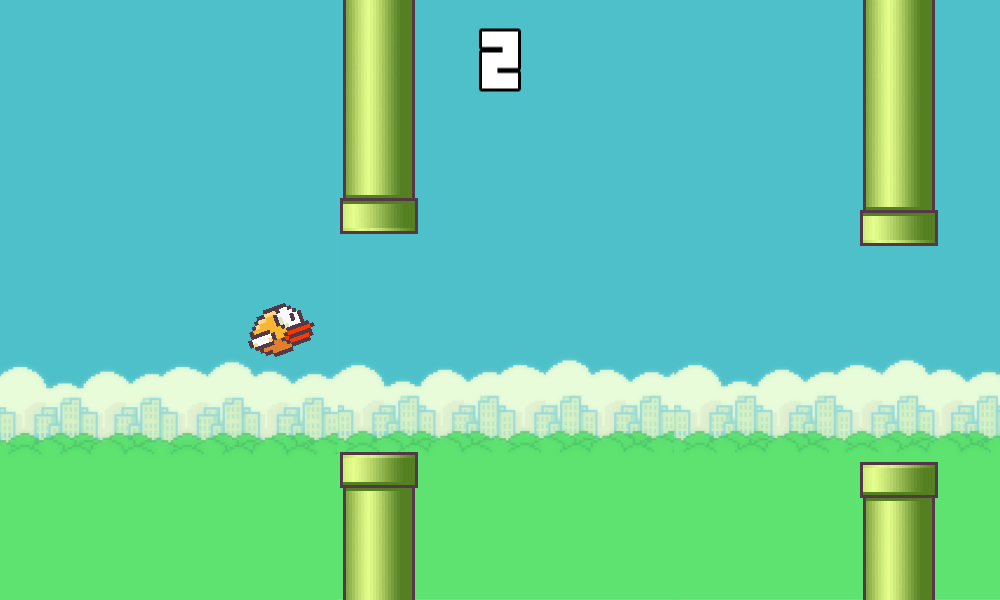
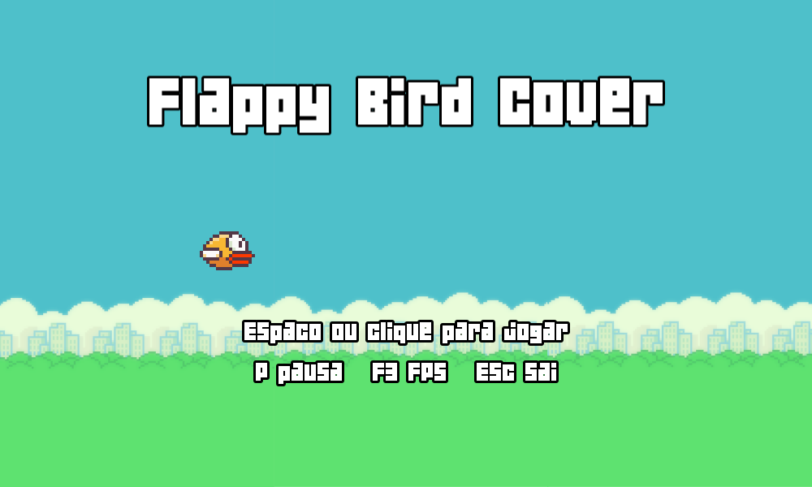
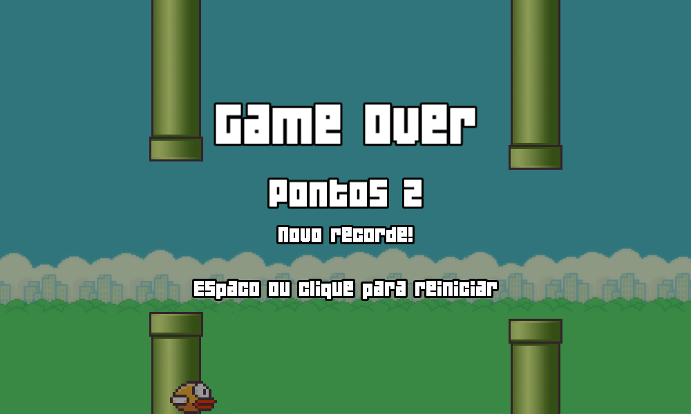
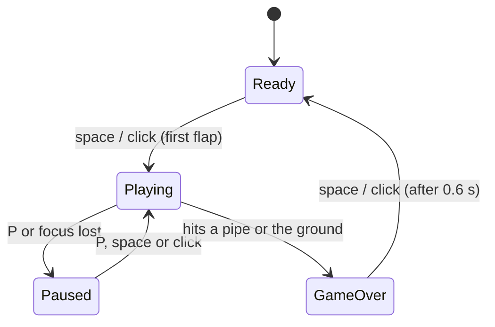

<p align="right">
  <a href="README.md">Português</a> | <strong>English</strong>
</p>

<h1 align="center">F L A P P Y &nbsp; B I R D &nbsp; C O V E R</h1>

<p align="center">
  <strong>One tap to rise. Gravity does the rest.</strong>
  <br/>
  <sub>2D pipe-dodging game in C++17 + SFML 3 — a study project with game logic testable without a window.</sub>
</p>

<p align="center">
  
  <a href="LICENSE"></a>
  
  
  
</p>

<p align="center">
  <a href="#installation-and-setup">Install</a> ·
  <a href="#why-flappy-bird-cover">Why</a> ·
  <a href="#features-and-capabilities">Features</a> ·
  <a href="#usage-guide">Usage</a> ·
  <a href="#architecture-and-technologies">Architecture</a> ·
  <a href="#quality-tests-and-validation">Tests</a> ·
  <a href="#documentation">Docs</a>
</p>

<p align="center">
  
</p>

**Fixed-step game loop, per-second physics, collision and scoring in a pure C++ core — `make test` runs without SFML or a display server.**

> [!IMPORTANT]
> **A study project, not affiliated with the original Flappy Bird.** "Flappy Bird" is a trademark of its owners. The code is MIT-licensed, but the sprites and font in `resources/` have **unknown origin and license** and are not covered by the project's license ([NOTICE.md](NOTICE.md)). Validated only on Gentoo Linux with SFML 3.0.1; sounds and music are not implemented yet.

---

## Why Flappy Bird Cover?

| Problem | What Happens | Flappy Bird Cover Fix |
| :--- | :--- | :--- |
| Physics tied to FPS | The bird falls faster on fast machines | Per-second units and a fixed 1/120 s step with an accumulator |
| Logic mixed with the window | Testing means opening the game | `src/core/` does not include SFML ([ADR 0001](docs/adr/0001-separar-nucleo-e-apresentacao.md)) |
| Untestable randomness | Different pipes every run prevent tests | Seed injected into `World` |
| Scattered constants | Tuning difficulty means hunting numbers in the code | Everything in [`GameConfig.hpp`](src/core/GameConfig.hpp) |

---

## Overview

Flappy Bird Cover is a 2D desktop game. The player controls a bird that falls under gravity and rises with each tap, passing through the gaps between pairs of pipes moving from right to left. Each pair passed is worth one point; touching a pipe or the ground ends the run.

Besides the game, the project is a lab for studying modern C++, SFML, object orientation, game loops, physics, collision, animation, code organization and Git.

The code is split into two layers:

- **Core** (`src/core/`): game rules in pure C++, without SFML, covered by automated tests.
- **Presentation** (`src/app/`): window, input, game loop and drawing with SFML 3.

Audience: the author and anyone studying game development in C++. Runtime environment: Linux desktop with a graphical session. It is unrelated to the workspace's other products.

## Project principles

| Principle | How it shows |
| --- | --- |
| Logic independent of the graphics library | `src/core/` does not include SFML; `src/app/Game` only translates events and draws ([ADR 0001](docs/adr/0001-separar-nucleo-e-apresentacao.md)) |
| Frame-rate-independent physics | Units per second and simulation at a fixed 1/120 s step with an accumulator; frame time capped at 0.25 s |
| Testability | Randomness injected by seed into `World`; `make test` runs without SFML or a display server |
| Centralized parameters | Gravity, speeds, gap, spacing and restart delay in [`GameConfig.hpp`](src/core/GameConfig.hpp) |
| Explicit failures | A missing resource quits with a message and exit code 1; missing SFML or SFML 2 is refused by `make` with fix instructions |
| Reproducibility | SFML pinned at 3.0.1 in the build script and in CI; GitHub actions pinned by version |

## Usage scenarios

| Scenario | In practice |
| --- | --- |
| Play | Build and run with `make run` |
| Study the game loop | Read `Game::run()` in [`Game.cpp`](src/app/Game.cpp), with a fixed step and accumulator |
| Tune the gameplay | Change constants in [`GameConfig.hpp`](src/core/GameConfig.hpp) and rebuild |
| Practice C++ testing | Add cases to [`tests/core_tests.cpp`](tests/core_tests.cpp) and run `make test` |
| Build on a distro without SFML 3 | Build SFML locally with `scripts/build-sfml.sh` and compile with `make SFML_PREFIX=<prefix>` |

## Features and capabilities

| Module | Capabilities | Status |
| --- | --- | --- |
| States | Start screen, playing, pause and game over | Implemented and tested |
| Physics | Gravity, flap impulse, terminal fall speed, tilt according to speed | Implemented and tested |
| Pipes | Random generation with the gap always visible and constant spacing | Implemented and tested |
| Collision | Axis-aligned boxes; bird hitbox 8 px smaller per side; the ceiling limits without killing | Implemented and tested |
| Scoring | One point per pipe pair passed | Implemented and tested |
| Difficulty | Each point makes pipes 4 px/s faster (up to 380 px/s) and the gap 2 px smaller (down to 165 px) | Implemented and tested |
| High score | Persisted to a file; shown on the start and game over screens | Implemented, tested and manually validated |
| Pause | `P` key; automatic pause when the window loses focus | Logic tested; window integration untested |
| FPS counter | `F3` key | Implemented; no automated test |
| Animation | 3 wing frames at 9 frames/s; wings stop outside a run | Implemented; no automated test |
| Sounds and music | — | Planned |

<table>
<tr>
<td></td>
<td></td>
</tr>
<tr>
<td align="center">Start screen</td>
<td align="center">Game over</td>
</tr>
</table>

## How it works



Each frame, `Game::run()`:

1. measures the frame time, capped at 0.25 s;
2. handles window, keyboard and mouse events;
3. advances `World::update()` in fixed 1/120 s steps while accumulated time remains;
4. saves the high score if it increased;
5. draws the background, pipes, bird and text.

On game over the pipes stop and the bird keeps falling to the ground.

## Requirements and compatibility

| Platform or environment | Requirements | Status |
| --- | --- | --- |
| Gentoo Linux, GCC 16.2.1, SFML 3.0.1 (`media-libs/libsfml`) | GNU Make, `pkg-config`, graphical session (X11 or XWayland) | Validated: warning-free build, tests and real runs |
| Ubuntu 24.04 (CI) | SFML 3.0.1 built by `scripts/build-sfml.sh` | Build and tests passed in CI; game not run |
| Other Linux distros with SFML 3 | C++17 compiler, GNU Make, `pkg-config` | Not validated |
| Windows and macOS | — | Not supported by the Makefile; not tested |

SFML 2.x is incompatible: `make` checks the version and stops the build if it finds one older than 3.0.

## Installation and setup

### 1. Dependencies

Gentoo (validated):

```bash
sudo emerge --ask media-libs/libsfml
```

Arch (not validated; make sure the `sfml` package is version 3):

```bash
sudo pacman -S --needed base-devel pkgconf sfml
```

Distros without packaged SFML 3, such as Ubuntu 24.04 (which ships 2.6): install the build dependencies, the same ones used in CI, and go to step 3.

```bash
sudo apt install build-essential cmake pkg-config libx11-dev libxrandr-dev libxcursor-dev libxi-dev libudev-dev libgl1-mesa-dev libegl1-mesa-dev libfreetype-dev
```

### 2. Code

```bash
git clone https://github.com/luisgazola/flappy-bird-cover.git
```

```bash
cd flappy-bird-cover
```

### 3. Local SFML (only without SFML 3 on the system)

```bash
./scripts/build-sfml.sh .deps/sfml
```

Details in [Specialized modules and resources](#specialized-modules-and-resources).

### 4. Build

With system SFML:

```bash
make
```

With local SFML:

```bash
make SFML_PREFIX="$PWD/.deps/sfml"
```

### 5. Basic check

```bash
make test
```

The expected output ends with `15 testes, 0 verificações falharam`. There are no mandatory environment variables or credentials.

## Usage guide

Run from the project root, because resources are read from `resources/`:

```bash
make run
```

### Controls

| Key or action | Effect |
| --- | --- |
| `Space`, `↑`, `W` or left click | Starts, flaps or restarts |
| `P` | Pauses or resumes |
| `F3` | Shows or hides the FPS counter |
| `Esc` | Quits |

### Makefile commands

| Command | Purpose |
| --- | --- |
| `make` | Builds the `flappy` executable |
| `make run` | Builds and runs |
| `make test` | Builds and runs the core tests (no SFML needed) |
| `make clean` | Removes `build/` and the executable |
| `make SFML_PREFIX=<dir>` | Uses an SFML installed outside the system paths |

### Known errors

| Message | Cause | Fix |
| --- | --- | --- |
| `Erro: SFML 3 (sfml-graphics >= 3.0) não encontrado` | SFML missing or version 2 | Install SFML 3 or use `scripts/build-sfml.sh` |
| `Erro: Falha ao carregar o recurso: resources/...` | Executable started outside the project root | Run from the root or with `make run` |
| `make: *** Sem regra para processar o alvo` | Command run outside the project folder | Enter the repository folder before running `make` |
| `Aviso: não foi possível salvar o recorde em ...` | No write permission on the directory | Check `XDG_DATA_HOME`; the game continues without persisting |

## Specialized modules and resources

**Local SFML build.** [`scripts/build-sfml.sh`](scripts/build-sfml.sh) downloads the SFML 3.0.1 source from the official GitHub repository, builds only the `system`, `window` and `graphics` modules and installs them to the given prefix (default: `.deps/sfml`), without `sudo`. It needs `curl`, CMake and the development libraries listed in the installation. The script also fixes the `libdir` of the `.pc` files generated by SFML 3.0.1. Validated on Gentoo; used by CI on Ubuntu 24.04. `.deps/` is ignored by Git.

**High score persistence.** `HighScoreStore` writes a single integer, creating the needed directories. Invalid or negative content is read as 0; a write failure prints a warning to the terminal and the game goes on.

**Progressive difficulty.** Computed in `World::currentPipeSpeed()` and `World::currentPipeGap()` from the score, with limits set in `GameConfig.hpp`. Each pair's gap is fixed when it is generated.

## Data, reports and evidence

| File or format | Purpose |
| --- | --- |
| `$XDG_DATA_HOME/flappy-bird-cover/highscore.txt` | High score. Without `XDG_DATA_HOME`, uses `~/.local/share/flappy-bird-cover/highscore.txt`; without `HOME`, uses `./highscore.txt` |
| `resources/img/*.png`, `resources/font/*.ttf` | Game sprites, background and font |
| `docs/images/*.png` | Screenshots generated from the current code |
| `docs/adr/*.md` | Architecture decisions |

The game neither collects, sends nor stores personal data.

## Architecture and technologies

| Layer | Directory | Responsibility | Depends on SFML |
| --- | --- | --- | --- |
| Core | `src/core/` | States, physics, pipes, collision, scoring, high score | No |
| Presentation | `src/app/` | Window, events, game loop, sprites and text | Yes |
| Entry | `src/main.cpp` | Creates `Game` and turns exceptions into an error message | Yes |

| Component | Role |
| --- | --- |
| `World` | State machine and rules; receives a random seed and the initial high score |
| `Bird` | Position, velocity, impulse, tilt and hitbox |
| `PipePair` | A pipe pair and its collision boxes |
| `Rect` | Rectangle and intersection test |
| `HighScoreStore` | Reading and writing the high score |
| `GameConfig.hpp` | Gameplay constants |
| `Game` | SFML integration |

Technologies: C++17, SFML 3, GNU Make, `pkg-config`, GitHub Actions. Decisions in [docs/adr/](docs/adr/).

```text
.
├── .github/workflows/ci.yml
├── docs
│   ├── adr/0001-separar-nucleo-e-apresentacao.md
│   └── images/
├── resources
│   ├── font/flappybird.ttf
│   └── img/
├── scripts/build-sfml.sh
├── src
│   ├── app/          Game.hpp, Game.cpp
│   ├── core/         Bird, World, PipePair, Rect, HighScoreStore, GameConfig
│   └── main.cpp
├── tests/core_tests.cpp
├── AGENTS.md, CLAUDE.md
├── LICENSE, NOTICE.md, SECURITY.md, CONTRIBUTING.md, CODE_OF_CONDUCT.md
├── MAINTAINERS.md, REPORT.md, HANDOFF.md
├── Makefile
└── README.md, README.en-US.md
```

## Quality, tests and validation

```bash
make test
```

| Suite or check | Type | Recorded result |
| --- | --- | --- |
| Core (`tests/core_tests.cpp`) | Automated | 15/15 on Gentoo (GCC 16.2.1) |
| Build with strict warnings | Automated | No warnings with `-Wall -Wextra -Wpedantic -Wshadow -Wconversion` |
| Build with SFML from `scripts/build-sfml.sh` | Integration | Passed on Gentoo |
| Real runs with SFML 3.0.1 | Manual validation | Runs played by the author; high score saved and read between executions |
| CI on Ubuntu 24.04 (GitHub Actions) | Automated | `make test` and build with SFML 3.0.1 passed |

The core tests include an autopilot that flies through pipes and checks that the score goes up one by one.

CI ([.github/workflows/ci.yml](.github/workflows/ci.yml)) runs `make test` and the full build with SFML 3.0.1 on Ubuntu 24.04 on every push and pull request.

**Not covered:** the SFML layer (`src/app/`) has no automated tests; the game has not been run outside Gentoo; there is no performance measurement.

## Security and privacy

The game runs without privileges, uses no network, reads no credentials and only writes the high score file. Installing SFML through the package manager requires `sudo`; `scripts/build-sfml.sh` does not. The script downloads code from the official SFML GitHub repository; review it before running it. Reporting policy in [SECURITY.md](SECURITY.md).

## Evolution and roadmap

Implemented:

- Window, background, bird, pipes, scoring, game over and restart.
- Start menu, pause and FPS counter.
- State system and `Bird`, `PipePair` and `Rect` classes.
- Frame-rate-independent physics and automated core tests.
- High score saving.

Planned, no dates:

- Sounds and music.
- Resource, animation and interface managers.
- JSON configuration.

## Contributing

A personal study project. Full guide in [CONTRIBUTING.md](CONTRIBUTING.md), under the [Code of conduct](CODE_OF_CONDUCT.md). In short:

- Use Conventional Commits (`feat:`, `fix:`, `docs:`, `refactor:`, `test:`, `chore:`).
- Behavior changes in `src/core/` require a test in `tests/core_tests.cpp`.
- Build without warnings and run `make test` before opening a PR; CI must pass.
- Record relevant decisions in `docs/adr/`.
- Keep `src/core/` free of SFML.

## Documentation

Project documentation is written in Portuguese.

- [ADR 0001 — separate core and presentation](docs/adr/0001-separar-nucleo-e-apresentacao.md) · [Screenshots](docs/images/)
- [Status report](REPORT.md) · [Handoff](HANDOFF.md) · [Agent instructions](AGENTS.md)
- [Contributing](CONTRIBUTING.md) · [Code of conduct](CODE_OF_CONDUCT.md) · [Security policy](SECURITY.md)

## Contributors & lineage

Created and maintained by Luís Fernando Gazola ([luisgazola](https://github.com/luisgazola)); responsibilities in [MAINTAINERS.md](MAINTAINERS.md). Inspired by the game Flappy Bird, with no affiliation to its owners. Public repository: [github.com/luisgazola/flappy-bird-cover](https://github.com/luisgazola/flappy-bird-cover).

## License

The **source code** is under the [MIT license](LICENSE), © 2026 Luís Fernando Gazola. The files in `resources/` (sprites and font) are **not** covered: their origin and license are not documented. Details in [NOTICE.md](NOTICE.md).

---

<p align="center">
  <em>"One more pipe. Just one more."</em>
  <br/><br/>
  <strong>Flappy Bird Cover</strong> · C++17 and SFML 3
</p>
