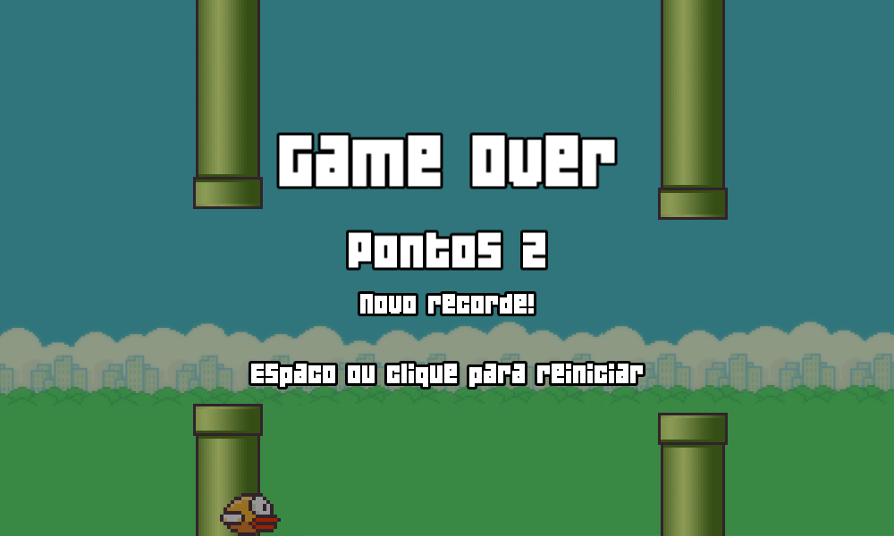
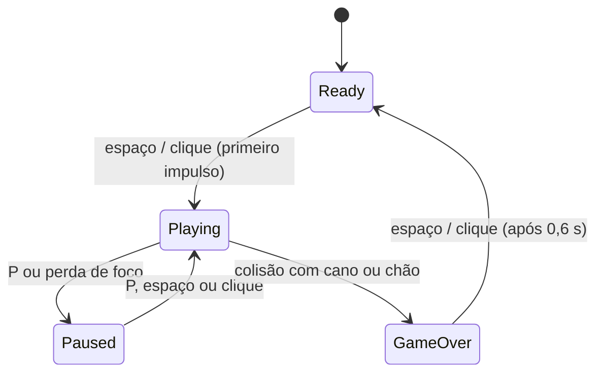

<div align="center">

# Flappy Bird Cover

**Jogo 2D de desviar de canos, escrito em C++17 com SFML 3**

Projeto de estudo de desenvolvimento de jogos: game loop, física, colisão, animação e arquitetura de software, com a lógica do jogo testável sem janela.

Luís Gazola


[Visão geral](#visão-geral) · [Funcionalidades](#funcionalidades-e-capacidades) · [Instalação](#instalação-e-configuração) · [Uso](#guia-de-utilização) · [Arquitetura](#arquitetura-e-tecnologias) · [Testes](#qualidade-testes-e-validações) · [Roadmap](#evolução-e-roadmap)


</div>

> [!NOTE]
> **Projeto de estudo.** Validado apenas no Gentoo Linux com SFML 3.0.1. Não há versão publicada, arquivo de licença nem origem documentada para os sprites e a fonte em `resources/`. Sons e música ainda não foram implementados.

---

## Visão geral

O Flappy Bird Cover é um jogo 2D para desktop. O jogador controla um pássaro que cai pela gravidade e sobe a cada toque, passando pelas aberturas entre pares de canos que se movem da direita para a esquerda. Cada par ultrapassado vale um ponto; tocar um cano ou o chão encerra a partida.

Além do jogo, o projeto funciona como laboratório para estudar C++ moderno, SFML, orientação a objetos, game loop, física, colisão, animação, organização de código e Git.

O código é dividido em duas camadas:

- **Núcleo** (`src/core/`): regras do jogo em C++ puro, sem SFML, cobertas por testes automatizados.
- **Apresentação** (`src/app/`): janela, entrada, game loop e desenho com SFML 3.

Público-alvo: o próprio autor e quem estuda desenvolvimento de jogos em C++. Ambiente de execução: desktop Linux com sessão gráfica. Não há relação com outros produtos do workspace.

## Princípios do projeto

| Princípio                                 | Como se manifesta                                                                                                                      |
| ----------------------------------------- | -------------------------------------------------------------------------------------------------------------------------------------- |
| Lógica independente da biblioteca gráfica | `src/core/` não inclui SFML; `src/app/Game` só traduz eventos e desenha ([ADR 0001](docs/adr/0001-separar-nucleo-e-apresentacao.md))   |
| Física independente da taxa de quadros    | Unidades por segundo e simulação em passo fixo de 1/120 s com acumulador; tempo de quadro limitado a 0,25 s                            |
| Testabilidade                             | Aleatoriedade injetada por semente em `World`; `make test` roda sem SFML nem servidor gráfico                                          |
| Parâmetros centralizados                  | Gravidade, velocidades, abertura, espaçamento e atraso de reinício em [`GameConfig.hpp`](src/core/GameConfig.hpp)                      |
| Falhas explícitas                         | Recurso ausente encerra com mensagem e código de saída 1; SFML ausente ou na versão 2 é recusado pelo `make` com instrução de correção |
| Reprodutibilidade                         | SFML fixado em 3.0.1 no script de compilação e na CI; actions do GitHub fixadas por versão                                             |

## Cenários de utilização

| Cenário                             | Aplicação prática                                                                               |
| ----------------------------------- | ----------------------------------------------------------------------------------------------- |
| Jogar                               | Compilar e executar com `make run`                                                              |
| Estudar game loop                   | Ler `Game::run()` em [`Game.cpp`](src/app/Game.cpp), com passo fixo e acumulador                |
| Ajustar a jogabilidade              | Alterar constantes em [`GameConfig.hpp`](src/core/GameConfig.hpp) e recompilar                  |
| Praticar testes em C++              | Acrescentar casos em [`tests/core_tests.cpp`](tests/core_tests.cpp) e rodar `make test`         |
| Compilar em distribuição sem SFML 3 | Gerar o SFML localmente com `scripts/build-sfml.sh` e compilar com `make SFML_PREFIX=<prefixo>` |

## Funcionalidades e capacidades

| Módulo          | Capacidades                                                                               | Situação                                          |
| --------------- | ----------------------------------------------------------------------------------------- | ------------------------------------------------- |
| Estados         | Tela inicial, partida, pausa e game over                                                  | Implementado e testado                            |
| Física          | Gravidade, impulso, velocidade máxima de queda, inclinação conforme a velocidade          | Implementado e testado                            |
| Canos           | Geração aleatória com abertura sempre visível e espaçamento constante                     | Implementado e testado                            |
| Colisão         | Caixas alinhadas aos eixos; hitbox do pássaro 8 px menor por lado; teto limita sem matar  | Implementado e testado                            |
| Pontuação       | Um ponto por par de canos ultrapassado                                                    | Implementado e testado                            |
| Dificuldade     | A cada ponto, canos 4 px/s mais rápidos (até 380 px/s) e abertura 2 px menor (até 165 px) | Implementado e testado                            |
| Recorde         | Persistido em arquivo; exibido na tela inicial e no game over                             | Implementado, testado e validado manualmente      |
| Pausa           | Tecla `P`; pausa automática ao perder o foco da janela                                    | Lógica testada; integração com a janela sem teste |
| Contador de FPS | Tecla `F3`                                                                                | Implementado; sem teste automatizado              |
| Animação        | 3 quadros de asa a 9 quadros/s; asas param fora da partida                                | Implementado; sem teste automatizado              |
| Sons e música   | —                                                                                         | Planejado                                         |

<table>
<tr>
<td></td>
<td></td>
</tr>
<tr>
<td align="center">Tela inicial</td>
<td align="center">Game over</td>
</tr>
</table>

## Fluxo de funcionamento



A cada quadro, `Game::run()`:

1. mede o tempo do quadro, limitado a 0,25 s;
2. trata eventos de janela, teclado e mouse;
3. avança `World::update()` em passos fixos de 1/120 s enquanto houver tempo acumulado;
4. grava o recorde se ele aumentou;
5. desenha fundo, canos, pássaro e textos.

No game over os canos param e o pássaro continua caindo até o chão.

## Requisitos e compatibilidade

| Plataforma ou ambiente                                      | Requisitos                                               | Situação                                            |
| ----------------------------------------------------------- | -------------------------------------------------------- | --------------------------------------------------- |
| Gentoo Linux, GCC 16.2.1, SFML 3.0.1 (`media-libs/libsfml`) | GNU Make, `pkg-config`, sessão gráfica (X11 ou XWayland) | Validado: build sem avisos, testes e partidas reais |
| Ubuntu 24.04 (CI)                                           | SFML 3.0.1 compilado por `scripts/build-sfml.sh`         | Build e testes aprovados na CI; jogo não executado  |
| Outras distribuições Linux com SFML 3                       | Compilador C++17, GNU Make, `pkg-config`                 | Não validado                                        |
| Windows e macOS                                             | —                                                        | Não suportado pelo Makefile; não testado            |

O SFML 2.x é incompatível: o `make` verifica a versão e interrompe a compilação se encontrar uma anterior à 3.0.

## Instalação e configuração

### 1. Dependências

Gentoo (validado):

```bash
sudo emerge --ask media-libs/libsfml
```

Arch (não validado; confirme que o pacote `sfml` está na versão 3):

```bash
sudo pacman -S --needed base-devel pkgconf sfml
```

Distribuições sem SFML 3 empacotado, como o Ubuntu 24.04 (que traz o 2.6): instale as dependências de compilação, que são as mesmas usadas na CI, e siga para o passo 3.

```bash
sudo apt install build-essential cmake pkg-config libx11-dev libxrandr-dev libxcursor-dev libxi-dev libudev-dev libgl1-mesa-dev libegl1-mesa-dev libfreetype-dev
```

### 2. Código

```bash
git clone https://github.com/luisgazola/flappy-bird-cover.git
```

```bash
cd flappy-bird-cover
```

### 3. SFML local (somente sem SFML 3 no sistema)

```bash
./scripts/build-sfml.sh .deps/sfml
```

Detalhes em [Módulos e recursos especializados](#módulos-e-recursos-especializados).

### 4. Compilação

Com SFML do sistema:

```bash
make
```

Com SFML local:

```bash
make SFML_PREFIX="$PWD/.deps/sfml"
```

### 5. Verificação básica

```bash
make test
```

A saída esperada termina com `15 testes, 0 verificações falharam`. Não há variáveis de ambiente obrigatórias nem credenciais.

## Guia de utilização

Execute a partir da raiz do projeto, porque os recursos são lidos de `resources/`:

```bash
make run
```

### Controles

| Tecla ou ação                         | Efeito                             |
| ------------------------------------- | ---------------------------------- |
| `Espaço`, `↑`, `W` ou clique esquerdo | Inicia, bate as asas ou reinicia   |
| `P`                                   | Pausa ou continua                  |
| `F3`                                  | Mostra ou oculta o contador de FPS |
| `Esc`                                 | Sai                                |

### Comandos do Makefile

| Comando                  | Função                                                   |
| ------------------------ | -------------------------------------------------------- |
| `make`                   | Compila o executável `flappy`                            |
| `make run`               | Compila e executa                                        |
| `make test`              | Compila e roda os testes do núcleo (não precisa de SFML) |
| `make clean`             | Remove `build/` e o executável                           |
| `make SFML_PREFIX=<dir>` | Usa um SFML instalado fora dos caminhos do sistema       |

### Erros conhecidos

| Mensagem                                             | Causa                                       | Solução                                                  |
| ---------------------------------------------------- | ------------------------------------------- | -------------------------------------------------------- |
| `Erro: SFML 3 (sfml-graphics >= 3.0) não encontrado` | SFML ausente ou na versão 2                 | Instalar o SFML 3 ou usar `scripts/build-sfml.sh`        |
| `Erro: Falha ao carregar o recurso: resources/...`   | Executável iniciado fora da raiz do projeto | Executar a partir da raiz ou com `make run`              |
| `make: *** Sem regra para processar o alvo`          | Comando executado fora da pasta do projeto  | Entrar na pasta do repositório antes de rodar o `make`   |
| `Aviso: não foi possível salvar o recorde em ...`    | Sem permissão de escrita no diretório       | Verificar `XDG_DATA_HOME`; o jogo continua sem persistir |

## Módulos e recursos especializados

**Compilação local do SFML.** [`scripts/build-sfml.sh`](scripts/build-sfml.sh) baixa o código-fonte do SFML 3.0.1 do repositório oficial no GitHub, compila só os módulos `system`, `window` e `graphics` e os instala no prefixo informado (padrão: `.deps/sfml`), sem `sudo`. Exige `curl`, CMake e as bibliotecas de desenvolvimento listadas na instalação. O script também corrige o `libdir` dos arquivos `.pc` gerados pelo SFML 3.0.1. Validado no Gentoo; usado pela CI no Ubuntu 24.04. O `.deps/` é ignorado pelo Git.

**Persistência do recorde.** `HighScoreStore` grava um único número inteiro, criando os diretórios necessários. Conteúdo inválido ou negativo é lido como 0; falha de gravação gera aviso no terminal e o jogo segue.

**Dificuldade progressiva.** Calculada em `World::currentPipeSpeed()` e `World::currentPipeGap()` a partir da pontuação, com limites definidos em `GameConfig.hpp`. A abertura de cada par é fixada no momento em que ele é gerado.

## Dados, relatórios e evidências

| Arquivo ou formato                               | Finalidade                                                                                                            |
| ------------------------------------------------ | --------------------------------------------------------------------------------------------------------------------- |
| `$XDG_DATA_HOME/flappy-bird-cover/highscore.txt` | Recorde. Sem `XDG_DATA_HOME`, usa `~/.local/share/flappy-bird-cover/highscore.txt`; sem `HOME`, usa `./highscore.txt` |
| `resources/img/*.png`, `resources/font/*.ttf`    | Sprites, fundo e fonte do jogo                                                                                        |
| `docs/images/*.png`                              | Capturas das telas geradas a partir do código atual                                                                   |
| `docs/adr/*.md`                                  | Decisões de arquitetura                                                                                               |

O jogo não coleta, não envia e não armazena dados pessoais.

## Arquitetura e tecnologias

| Camada       | Diretório      | Responsabilidade                                      | Depende de SFML |
| ------------ | -------------- | ----------------------------------------------------- | --------------- |
| Núcleo       | `src/core/`    | Estados, física, canos, colisão, pontuação, recorde   | Não             |
| Apresentação | `src/app/`     | Janela, eventos, game loop, sprites e textos          | Sim             |
| Entrada      | `src/main.cpp` | Cria o `Game` e converte exceções em mensagem de erro | Sim             |

| Componente       | Papel                                                                   |
| ---------------- | ----------------------------------------------------------------------- |
| `World`          | Máquina de estados e regras; recebe semente aleatória e recorde inicial |
| `Bird`           | Posição, velocidade, impulso, inclinação e hitbox                       |
| `PipePair`       | Par de canos e suas caixas de colisão                                   |
| `Rect`           | Retângulo e teste de interseção                                         |
| `HighScoreStore` | Leitura e gravação do recorde                                           |
| `GameConfig.hpp` | Constantes de jogabilidade                                              |
| `Game`           | Integração com SFML                                                     |

Tecnologias: C++17, SFML 3, GNU Make, `pkg-config`, GitHub Actions. Decisões em [docs/adr/](docs/adr/).

```text
.
├── .github/workflows/ci.yml
├── docs
│   ├── adr/0001-separar-nucleo-e-apresentacao.md
│   └── images/
├── resources
│   ├── font/flappybird.ttf
│   └── img/
├── scripts/build-sfml.sh
├── src
│   ├── app/          Game.hpp, Game.cpp
│   ├── core/         Bird, World, PipePair, Rect, HighScoreStore, GameConfig
│   └── main.cpp
├── tests/core_tests.cpp
├── CLAUDE.md
├── Makefile
└── README.md
```

## Qualidade, testes e validações

```bash
make test
```

| Suíte ou verificação                      | Tipo             | Resultado registrado                                                |
| ----------------------------------------- | ---------------- | ------------------------------------------------------------------- |
| Núcleo (`tests/core_tests.cpp`)           | Automatizado     | 15/15 no Gentoo (GCC 16.2.1)                                        |
| Compilação com avisos estritos            | Automatizado     | Sem avisos com `-Wall -Wextra -Wpedantic -Wshadow -Wconversion`     |
| Build com SFML de `scripts/build-sfml.sh` | Integração       | Aprovado no Gentoo                                                  |
| Partidas reais com SFML 3.0.1             | Validação manual | Partidas jogadas pelo autor; recorde gravado e lido entre execuções |
| CI no Ubuntu 24.04 (GitHub Actions)       | Automatizado     | `make test` e build com SFML 3.0.1 aprovados                        |

Os testes do núcleo incluem um piloto automático que atravessa canos e verifica que a pontuação sobe de um em um.

A CI ([.github/workflows/ci.yml](.github/workflows/ci.yml)) roda `make test` e a compilação completa com SFML 3.0.1 no Ubuntu 24.04 a cada push e pull request.

**Sem cobertura:** a camada SFML (`src/app/`) não tem testes automatizados; o jogo não foi executado fora do Gentoo; não há medição de desempenho.

## Segurança e privacidade

O jogo roda sem privilégios, não usa rede, não lê credenciais e só grava o arquivo de recorde. A instalação do SFML pelo gerenciador de pacotes exige `sudo`; o script `scripts/build-sfml.sh` não. O script baixa código do repositório oficial do SFML no GitHub; revise-o antes de executar. Não há `SECURITY.md`.

## Evolução e roadmap

Implementado:

- Janela, fundo, pássaro, canos, pontuação, game over e reinício.
- Menu inicial, pausa e contador de FPS.
- Sistema de estados e classes `Bird`, `PipePair` e `Rect`.
- Física independente da taxa de quadros e testes automatizados do núcleo.
- Gravação do recorde.

Previsto, sem prazos definidos:

- Sons e música.
- Gerenciadores de recursos, animação e interface.
- Configuração em JSON.

## Contribuição

Projeto pessoal de estudo; não há `CONTRIBUTING.md` nem `CODE_OF_CONDUCT.md`. Para quem trabalhar no código:

- Use Conventional Commits (`feat:`, `fix:`, `docs:`, `refactor:`, `test:`, `chore:`).
- Mudança de comportamento em `src/core/` exige teste em `tests/core_tests.cpp`.
- Compile sem avisos e rode `make test` antes de abrir PR; a CI precisa passar.
- Registre decisões relevantes em `docs/adr/`.
- Mantenha `src/core/` sem dependência de SFML.

## Autoria, manutenção e licença

- **Autor e mantenedor:** Luís Gazola ([@luisgazola](https://github.com/luisgazola)).
- **Repositório:** [github.com/luisgazola/flappy-bird-cover](https://github.com/luisgazola/flappy-bird-cover) (público).
- **Licença:** não definida. Não há arquivo `LICENSE`; o projeto é destinado exclusivamente para estudos.
- **Recursos:** origem e licença dos sprites e da fonte em `resources/` não documentadas.

---

<div align="center">

**Flappy Bird Cover** · jogo 2D em C++17 e SFML 3

Luís Gazola

</div>
