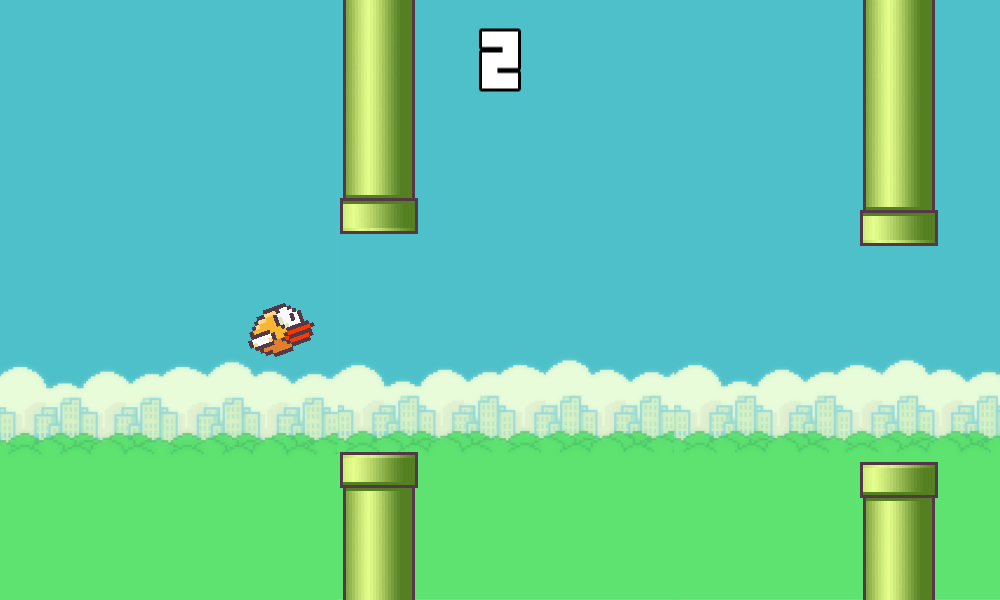
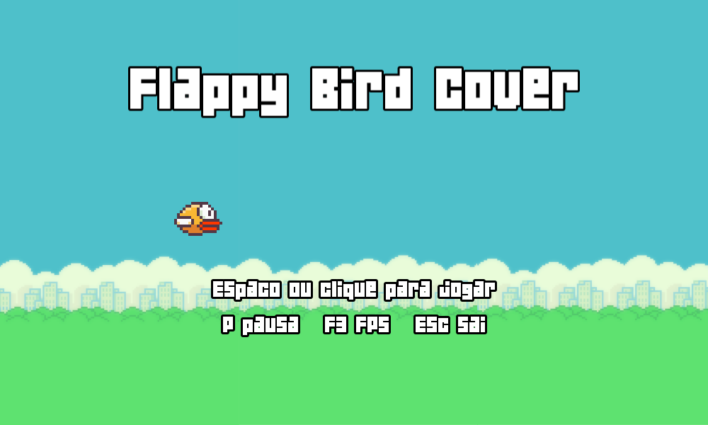
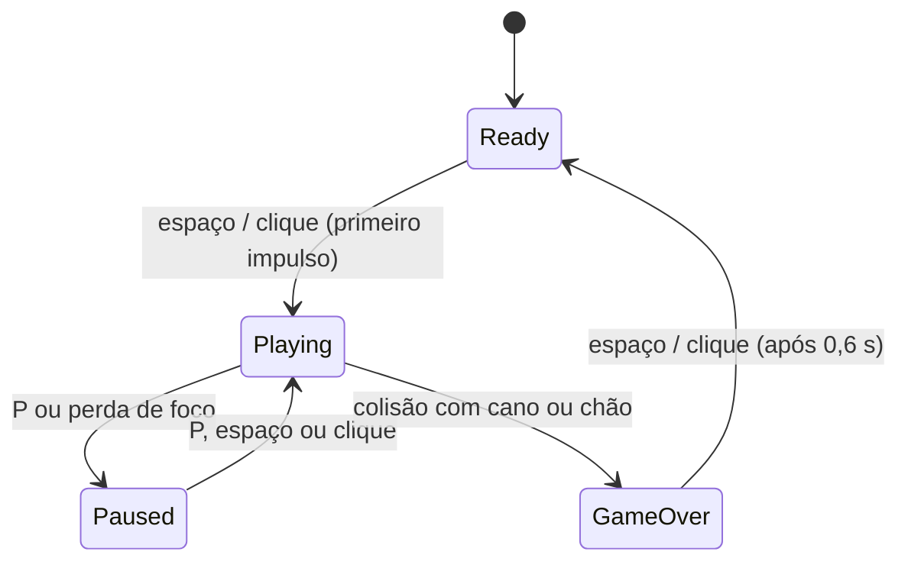

<div align="center">

# Flappy Bird Cover

**Jogo 2D de desviar de canos, escrito em C++17 com SFML 3**

Projeto de estudo de desenvolvimento de jogos: game loop, física, colisão, animação e arquitetura de software.

Por [Luís Gazola](https://github.com/luisgazola)


[Visão geral](#visão-geral) ·
[Funcionalidades](#funcionalidades) ·
[Instalação](#instalação) ·
[Como jogar](#como-jogar) ·
[Arquitetura](#arquitetura) ·
[Testes](#qualidade-e-testes) ·
[Roadmap](#roadmap)



</div>

---

## Visão geral

O jogador controla um pássaro que cai pela gravidade e sobe a cada toque, passando pelas aberturas entre pares de canos que se movem da direita para a esquerda. Cada par ultrapassado vale um ponto; tocar um cano ou o chão encerra a partida.

O objetivo do projeto não é só o jogo: ele serve de laboratório para estudar C++ moderno, SFML, orientação a objetos, game loop, física, colisão, animação, organização de código e Git.

O código separa as **regras do jogo** (C++ puro, testável sem janela) da **apresentação** (SFML). Detalhes em [Arquitetura](#arquitetura).

## Princípios do projeto

| Princípio | Como aparece no código |
| --- | --- |
| Lógica independente da biblioteca gráfica | `src/core/` não inclui SFML; `src/app/` só traduz eventos e desenha |
| Física independente da taxa de quadros | Unidades por segundo e simulação em passo fixo de 1/120 s |
| Testabilidade | Aleatoriedade injetada por semente em `World`; `make test` roda sem janela |
| Parâmetros centralizados | Gravidade, velocidades, abertura e espaçamento em [`GameConfig.hpp`](src/core/GameConfig.hpp) |
| Falhas explícitas | Recurso ausente encerra com mensagem e código de saída 1 |

## Cenários de utilização

| Cenário | Aplicação prática |
| --- | --- |
| Jogar | Compilar e rodar com `make run` |
| Estudar game loop | Ler `Game::run()` e o acumulador de passo fixo em [`Game.cpp`](src/app/Game.cpp) |
| Ajustar jogabilidade | Alterar constantes em [`GameConfig.hpp`](src/core/GameConfig.hpp) e recompilar |
| Praticar testes em C++ | Acrescentar casos em [`tests/core_tests.cpp`](tests/core_tests.cpp) |

## Funcionalidades

| Módulo | Capacidades | Estado |
| --- | --- | --- |
| Estados | Tela inicial, partida, pausa e game over | Implementado e testado |
| Física | Gravidade, impulso, velocidade máxima de queda, inclinação pela velocidade | Implementado e testado |
| Canos | Geração aleatória com abertura sempre visível e espaçamento constante | Implementado e testado |
| Colisão | Caixas alinhadas aos eixos; hitbox do pássaro reduzida em 8 px por lado | Implementado e testado |
| Pontuação | Um ponto por par de canos ultrapassado | Implementado e testado |
| Dificuldade | A cada ponto, canos 4 px/s mais rápidos (até 380) e abertura 2 px menor (até 165) | Implementado e testado |
| Recorde | Salvo em arquivo e exibido na tela inicial e no game over | Implementado e testado |
| Pausa | Tecla `P`; pausa automática ao perder o foco da janela | Lógica testada; integração com a janela sem teste automatizado |
| Contador de FPS | Tecla `F3` | Implementado; sem teste automatizado |
| Animação | 3 quadros de asa a 9 quadros/s | Implementado; sem teste automatizado |
| Sons e música | — | Planejado |

<table>
<tr>
<td></td>
<td></td>
</tr>
<tr>
<td align="center">Tela inicial</td>
<td align="center">Game over</td>
</tr>
</table>

## Fluxo de funcionamento



A cada quadro, `Game::run()`:

1. mede o tempo do quadro (limitado a 0,25 s);
2. trata os eventos de janela, teclado e mouse;
3. avança `World::update()` em passos fixos de 1/120 s enquanto houver tempo acumulado;
4. salva o recorde se ele aumentou;
5. desenha fundo, canos, pássaro e textos.

No game over os canos param e o pássaro continua caindo até o chão.

## Requisitos e compatibilidade

| Ambiente | Requisitos | Situação |
| --- | --- | --- |
| Gentoo Linux, GCC 16.2.1, SFML 3.0.1 (pacote `media-libs/libsfml`) | Sessão gráfica (X11 ou XWayland) | Validado: build, testes e partidas |
| Outras distribuições Linux com SFML 3 | Compilador C++17, GNU Make, `pkg-config` | Não validado |
| Linux sem SFML 3 empacotado (ex.: Ubuntu 24.04, que traz 2.6) | CMake, `curl` e dependências de compilação do SFML | SFML compilado com `scripts/build-sfml.sh` validado no Gentoo |
| Windows / macOS | — | Não suportado pelo Makefile; não testado |

O SFML 2.x é **incompatível**. O `make` verifica a versão e avisa caso encontre uma anterior à 3.0.

## Instalação

### 1. Dependências

Gentoo (validado):

```bash
sudo emerge --ask media-libs/libsfml
```

Arch (não validado; confirme que o pacote `sfml` está na versão 3):

```bash
sudo pacman -S --needed base-devel pkgconf sfml
```

Distribuições sem SFML 3 empacotado: instale compilador, CMake e as bibliotecas de desenvolvimento usadas pelo SFML (no Ubuntu/Debian, por exemplo: `build-essential cmake pkg-config libx11-dev libxrandr-dev libxcursor-dev libxi-dev libudev-dev libgl1-mesa-dev libegl1-mesa-dev libfreetype-dev`, a mesma lista usada no CI) e compile o SFML localmente:

```bash
./scripts/build-sfml.sh .deps/sfml
```

O script baixa o código-fonte do SFML 3.0.1 do GitHub oficial e instala só os módulos `system`, `window` e `graphics` no prefixo informado, sem precisar de `sudo`.

### 2. Código

```bash
git clone https://github.com/luisgazola/flappy-bird-cover.git
```

```bash
cd flappy-bird-cover
```

### 3. Compilação

Com SFML do sistema:

```bash
make
```

Com SFML compilado pelo script:

```bash
make SFML_PREFIX="$PWD/.deps/sfml"
```

## Como jogar

Execute a partir da raiz do projeto, porque os recursos são lidos de `resources/`:

```bash
make run
```

| Tecla / ação | Efeito |
| --- | --- |
| `Espaço`, `↑`, `W` ou clique esquerdo | Inicia, bate as asas ou reinicia |
| `P` | Pausa / continua |
| `F3` | Mostra / oculta o contador de FPS |
| `Esc` | Sai |

### Comandos do Makefile

| Comando | Função |
| --- | --- |
| `make` | Compila o executável `flappy` |
| `make run` | Compila e executa |
| `make test` | Compila e roda os testes da lógica (não precisa de SFML) |
| `make clean` | Remove `build/` e o executável |
| `make SFML_PREFIX=<dir>` | Usa um SFML fora dos caminhos do sistema |

### Erros conhecidos

| Mensagem | Causa | Solução |
| --- | --- | --- |
| `Erro: SFML 3 (sfml-graphics >= 3.0) não encontrado` | SFML ausente ou na versão 2 | Instalar SFML 3 ou usar `scripts/build-sfml.sh` |
| `Erro: Falha ao carregar o recurso: resources/...` | Executado fora da raiz do projeto | Rodar a partir da raiz ou com `make run` |
| `make: *** Sem regra para processar o alvo` | Comando executado fora da pasta do projeto | Entrar na pasta do repositório |

## Dados gerados

| Arquivo | Finalidade |
| --- | --- |
| `$XDG_DATA_HOME/flappy-bird-cover/highscore.txt` | Recorde (um número inteiro). Sem `XDG_DATA_HOME`, usa `~/.local/share/flappy-bird-cover/highscore.txt`; sem `HOME`, usa `./highscore.txt` |

O jogo não coleta nem envia dados. Conteúdo inválido ou negativo no arquivo de recorde é tratado como 0; se não for possível gravá-lo, o jogo exibe um aviso no terminal e continua.

## Arquitetura

| Camada | Diretório | Responsabilidade | Depende de SFML |
| --- | --- | --- | --- |
| Núcleo | `src/core/` | Estados, física, canos, colisão, pontuação, recorde | Não |
| Apresentação | `src/app/` | Janela, eventos, game loop, sprites e textos | Sim |
| Entrada | `src/main.cpp` | Cria o `Game` e converte exceções em mensagem de erro | Sim |

| Classe / arquivo | Papel |
| --- | --- |
| `World` | Máquina de estados e regras; recebe semente aleatória e recorde inicial |
| `Bird` | Posição, velocidade, impulso, inclinação e hitbox |
| `PipePair` | Par de canos e suas caixas de colisão |
| `Rect` | Retângulo e teste de interseção |
| `HighScoreStore` | Leitura e gravação do recorde |
| `GameConfig.hpp` | Constantes de jogabilidade |
| `Game` | Integração com SFML |

Decisão registrada em [docs/adr/0001-separar-nucleo-e-apresentacao.md](docs/adr/0001-separar-nucleo-e-apresentacao.md).

```text
.
├── .github/workflows/ci.yml
├── docs
│   ├── adr/0001-separar-nucleo-e-apresentacao.md
│   └── images/
├── resources
│   ├── font/flappybird.ttf
│   └── img/
├── scripts/build-sfml.sh
├── src
│   ├── app/              Game.hpp, Game.cpp
│   ├── core/             Bird, World, PipePair, Rect, HighScoreStore, GameConfig
│   └── main.cpp
├── tests/core_tests.cpp
├── CLAUDE.md
├── Makefile
└── README.md
```

## Qualidade e testes

| Tipo | Escopo | Como executar |
| --- | --- | --- |
| Automatizado (unitário) | 15 casos sobre `src/core`: física, colisão, geração de canos, pontuação (com piloto automático), pausa, reinício, dificuldade e recorde | `make test` |
| Integração contínua | `make test` e compilação completa com SFML 3.0.1 (via `scripts/build-sfml.sh`) em Ubuntu 24.04 | [`.github/workflows/ci.yml`](.github/workflows/ci.yml), a cada push e pull request |
| Validação manual | Partidas reais no Gentoo com SFML 3.0.1 (início, colisão, recorde salvo) | `make run` |

A compilação usa `-Wall -Wextra -Wpedantic -Wshadow -Wconversion`, sem avisos no ambiente validado.

Pendências: a camada SFML (`src/app/`) não tem testes automatizados.

## Segurança

O jogo roda sem privilégios, não usa rede e só grava o arquivo de recorde. O script `scripts/build-sfml.sh` baixa código do repositório oficial do SFML no GitHub; revise-o antes de executar.

## Roadmap

### Versão 1.0 — concluída

- [x] Janela, fundo, pássaro e canos
- [x] Pontuação, game over e reinício

### Versão 1.1

- [x] Menu inicial
- [x] Contador de FPS
- [x] Pausa
- [ ] Sons
- [ ] Música

### Versão 1.2 — concluída

- [x] Sistema de estados
- [x] Classes `Bird`, `PipePair` e `Rect`
- [x] Física independente de FPS
- [x] Testes automatizados da lógica

### Versão 2.0

- [x] Salvar recorde
- [ ] Resource Manager
- [ ] Animation Manager
- [ ] UI Manager
- [ ] Configuração em JSON

## Autoria e licença

Desenvolvido por **Luís Gazola** ([@luisgazola](https://github.com/luisgazola)).

O repositório não possui arquivo de licença; o projeto é destinado exclusivamente para estudos. A origem e a licença dos sprites e da fonte em `resources/` não estão documentadas.

---

<div align="center">
<sub>Flappy Bird Cover · projeto de estudo em C++ e SFML</sub>
</div>
